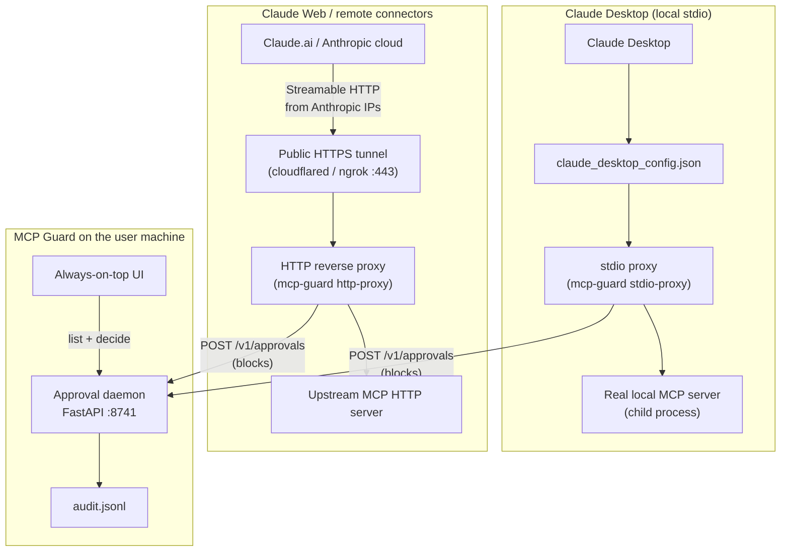
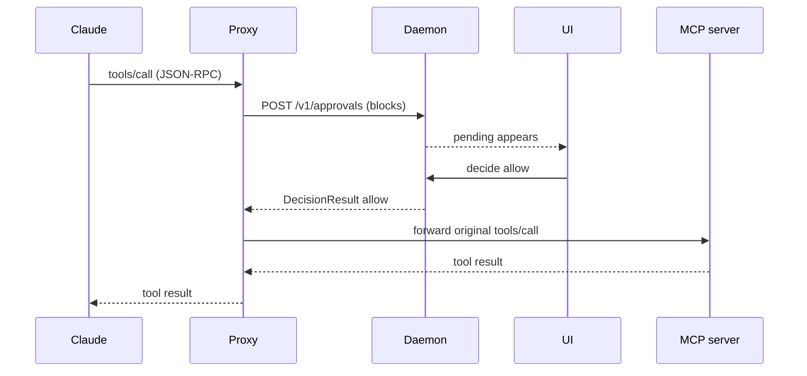

# Architecture

MCP Guard is a **human-in-the-loop approval gate** for Model Context Protocol
(MCP) `tools/call` requests. It does **not** instrument Claude’s UI and it does
**not** hook OS-level network stacks. Instead it sits on the MCP transport that
Claude already uses, which is the only practical place where a third-party tool
can reliably hold a request pending, allow it, or return a denial.

## Goals

| Goal | Approach |
|------|----------|
| See MCP tool invocations from Claude Desktop | Wrap each local stdio server in `claude_desktop_config.json` |
| See MCP tool invocations from Claude Web | Put a local Streamable HTTP reverse proxy in front of the remote server and point Claude’s custom connector at a public tunnel to that proxy |
| Hold the request until the user decides | Proxies call a local approval daemon that blocks until Allow/Block/timeout |
| Always-on-top confirmation | Separate UI process polling the daemon (Tkinter, topmost) |
| Fail safely | Default **fail-closed**: daemon down or timeout → JSON-RPC error, call never forwarded |
| Concurrent requests | One pending entry + waiter per request id in the daemon |

## High-level diagram

## How Claude actually speaks MCP

### Claude Desktop — local servers (stdio)

1. On launch, Claude Desktop reads
   `~/Library/Application Support/Claude/claude_desktop_config.json` (macOS) or
   `%APPDATA%\Claude\claude_desktop_config.json` (Windows).
2. For each entry under `mcpServers`, it spawns `command` + `args` as a child
   process and speaks **newline-delimited JSON-RPC** over that child’s
   stdin/stdout ([MCP stdio transport](https://modelcontextprotocol.io/specification/2025-11-25/basic/transports)).
3. Tool invocations are JSON-RPC requests with `"method": "tools/call"` and
   `params.name` / `params.arguments`.

**Interception:** `mcp-guard install` rewrites each entry so Claude launches the
stdio proxy instead. The proxy spawns the original command, relays all messages,
and **only** stalls on `tools/call`.

This matches the assignment hypothesis and is the industry-standard pattern for
stdio MCP policy proxies.

### Claude Web — remote connectors (Streamable HTTP / SSE)

Per Anthropic’s docs
([custom connectors](https://support.claude.com/en/articles/11175166-get-started-with-custom-connectors-using-remote-mcp)):

- Claude Web does **not** launch local stdio processes.
- Custom connectors call your MCP server from **Anthropic’s cloud**, not from
  the browser tab on your laptop.
- The server must be reachable on the public internet over **HTTPS port 443**.
- Preferred transport is **Streamable HTTP** (legacy HTTP+SSE still exists).

**Interception:** run `mcp-guard http-proxy --upstream <real MCP URL>`, expose
it with a tunnel (Cloudflare Tunnel / ngrok) on 443, and register that public
URL as the custom connector in Claude. Anthropic → tunnel → proxy → (approval)
→ upstream.

Desktop **remote** connectors use the same Anthropic-cloud path; local stdio
entries in `claude_desktop_config.json` are a separate mechanism.

## Component responsibilities

### Approval daemon (`mcp-guard daemon`)

- Loopback-only FastAPI server (`127.0.0.1:8741`).
- `POST /v1/approvals` — proxy submits a pending call and **waits** for the
  decision (or timeout).
- `GET /v1/approvals/pending` / `POST /v1/approvals/{id}/decide` — UI.
- Append-only JSONL audit log under the platform app-data directory.
- In-memory queue keyed by request id; safe for multiple simultaneous waiters.

### Stdio proxy (`mcp-guard stdio-proxy`)

- Child of Claude Desktop; parent of the real MCP server.
- Pass-through: `initialize`, `tools/list`, notifications, responses.
- Gate: `tools/call` → daemon → Allow forwards original frame; Block/timeout/
  daemon-down returns a JSON-RPC error (`-32042` / `-32044` / `-32043`).

### HTTP proxy (`mcp-guard http-proxy`)

- Reverse proxy for Streamable HTTP POST bodies.
- Same gate on JSON-RPC `tools/call`; other methods and SSE upstream streams
  are forwarded.
- Must be published via a tunnel for Claude Web.

### UI (`mcp-guard ui`)

- Tkinter always-on-top window when available; terminal fallback otherwise.
- Shows server name, tool name, pretty-printed arguments.
- Supports several pending panels at once; each has Allow / Block.
- Daemon enforces the timeout default (fail-closed → Block).

### Installer (`mcp-guard install` / `uninstall` / `restore`)

- Backs up `claude_desktop_config.json` before every write.
- Stores original command metadata for clean unwrap.
- `restore` copies the latest `.mcp-guard.bak` back into place.

## Request lifecycle (Allow)

## Fail-closed vs fail-open

| Condition | Default (fail-closed) | Fail-open (`MCP_GUARD_FAIL_OPEN=1`) |
|-----------|------------------------|--------------------------------------|
| User clicks Block | JSON-RPC error `-32042`, not forwarded | same |
| Approval timeout | JSON-RPC error `-32044`, not forwarded | forward without approval |
| Daemon unreachable | JSON-RPC error `-32043`, not forwarded | forward without approval |
| Proxy crash mid-call | Client sees broken pipe / HTTP 502; call may or may not have reached upstream depending on timing | same |

**Recommendation:** keep fail-closed for any real use. Fail-open exists only so
developers can debug connectivity without fighting the gate.

## What this design cannot do (honest limits)

1. **Built-in / directory connectors Anthropic hosts** — traffic never reaches
   your machine; there is no local hop to wrap.
2. **Claude Web → arbitrary remote MCP you do not control** — you can only
   intercept if Claude’s connector URL points at *your* proxy. You cannot
   silently MITM `https://someone-else.example/mcp` from a laptop process.
3. **Desktop Extensions (MCPB) that bypass `claude_desktop_config.json`** —
   the installer only rewrites the JSON stdio map. Extension-packaged servers
   need a separate packaging story (or unpack and wrap manually).
4. **Prompt / browser DOM scraping** — fragile, incomplete, and not a real
   protocol intercept. Intentionally out of scope.
5. **Encrypting Claude ↔ Anthropic chat traffic** — unrelated to MCP tool
   transport; not attempted.
6. **Linux Claude Desktop** — Anthropic’s shipping apps are macOS/Windows.
   Linux can run daemon/proxies/tests; there is no official Desktop config
   path to install into (community builds may use `~/.config/Claude/`).
7. **True “popup above everything” on every OS compositor** — Tkinter
   `-topmost` works on macOS/Windows for this demo; some Linux WMs ignore it.
8. **OAuth token mediation** — the HTTP proxy forwards headers; it does not
   implement OAuth for you. Point Claude’s connector auth at the proxied URL
   as you would at the upstream.

## Trade-offs vs alternatives

| Approach | Pros | Cons |
|----------|------|------|
| **Stdio wrapper + HTTP reverse proxy (this repo)** | Protocol-correct; holds the real request; works offline for Desktop; explainable | Web needs a tunnel; must own the connector URL; extensions need extra work |
| OS network MITM / packet filter | Could see raw HTTPS | Breaks TLS; cannot decode MCP without keys; overkill and brittle |
| Inject into Claude Desktop process | Might catch more surfaces | Undocumented, fragile across versions, poor interview signal |
| Claude’s own tool-approval UI only | Native UX | Not a take-home you control; doesn’t prove interception |

## Security notes (summary)

- Daemon and proxies bind to **localhost** by default.
- Audit log may contain tool arguments (secrets if models pass them) — treat
  `audit.jsonl` as sensitive.
- The installer never transmits config off-box; backups stay next to the
  Claude config file.
- Exposing the HTTP proxy via a tunnel publishes an MCP endpoint to the
  internet (Anthropic will call it). Add auth headers / OAuth on that
  connector and prefer ephemeral demo tunnels.

## Why this is interview-friendly

- Clear separation: **transport proxy** vs **policy daemon** vs **UI**.
- Same approval API for Desktop and Web.
- Explicit JSON-RPC denial codes and fail-closed semantics.
- Tests drive a real demo server through the proxy without Claude installed.
