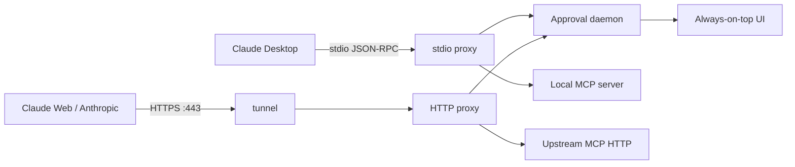

# MCP Guard

**Human-in-the-loop approval for Model Context Protocol (MCP) tool calls** from
Claude Desktop and Claude Web.

Whenever Claude tries to invoke an MCP tool, MCP Guard holds the request,
shows an always-on-top confirmation with the server name, tool, and parameters,
and only forwards the call if you click **Allow**. **Block** returns a
JSON-RPC error and the upstream server never sees the invocation.

> Take-home assignment · Deadline **Friday 20 Nov 2026, EOD IST**

---

## Quick start

```bash
python3 -m venv .venv
source .venv/bin/activate          # Windows: .venv\Scripts\activate
pip install -e ".[dev]"
pytest -q
```

Run the control plane (two processes):

```bash
mcp-guard daemon                   # terminal 1 — approval API + audit log
mcp-guard ui                       # terminal 2 — always-on-top Allow/Block UI
```

Wrap Claude Desktop’s local MCP servers (creates a backup first):

```bash
mcp-guard install
# Fully quit and restart Claude Desktop (Cmd+Q / tray Quit)
```

Restore original config:

```bash
mcp-guard restore
# or: mcp-guard uninstall
```

Step-by-step recording script: **[DEMO.md](./DEMO.md)**  
Design, trade-offs, and hard limits: **[ARCHITECTURE.md](./ARCHITECTURE.md)**

---

## Architecture (short)



| Path | How interception works |
|------|------------------------|
| **Claude Desktop (local)** | `claude_desktop_config.json` launches `mcp-guard stdio-proxy` instead of the real server. The proxy parses newline-delimited JSON-RPC and stalls on `tools/call`. |
| **Claude Web / remote** | A local Streamable HTTP reverse proxy fronts the real MCP URL. You expose it with Cloudflare Tunnel / ngrok and point Claude’s custom connector at that public URL. Anthropic’s cloud calls *you*; you gate `tools/call`. |

Both proxies share one localhost daemon that owns the approval queue, timeouts, and audit log.

---

## Features

- **Stdio proxy** for Claude Desktop local MCP servers
- **HTTP reverse proxy** for Claude Web / remote Streamable HTTP connectors
- **Always-on-top** Tkinter UI (terminal fallback) with multi-request panels
- **Installer** with backup / unwrap / restore for `claude_desktop_config.json`
- **Fail-closed** by default (daemon down or timeout → deny, do not forward)
- **JSON-RPC errors** on Block (`-32042`), timeout (`-32044`), daemon down (`-32043`)
- **Audit log** (JSONL) of every request and decision
- **Sample demo MCP servers** (stdio + HTTP)
- **pytest** suite including concurrency and proxy integration tests

---

## Requirements

| | |
|-|-|
| Python | 3.10+ |
| OS for Claude Desktop integration | **macOS** or **Windows** |
| Linux | Daemon, proxies, UI fallback, and tests work; official Claude Desktop is not shipped for Linux |
| Optional for Web demo | `cloudflared` or `ngrok` |

---

## Configuration

### Environment variables

| Variable | Default | Meaning |
|----------|---------|---------|
| `MCP_GUARD_DAEMON_HOST` | `127.0.0.1` | Daemon bind / client target |
| `MCP_GUARD_DAEMON_PORT` | `8741` | Daemon port |
| `MCP_GUARD_HTTP_PROXY_HOST` | `127.0.0.1` | HTTP proxy bind |
| `MCP_GUARD_HTTP_PROXY_PORT` | `8742` | HTTP proxy port |
| `MCP_GUARD_TIMEOUT` | `60` | Seconds to wait for Allow/Block |
| `MCP_GUARD_FAIL_CLOSED` | `1` | Deny on timeout / daemon down |
| `MCP_GUARD_FAIL_OPEN` | `0` | Debug only — forward if daemon/timeout fails |
| `MCP_GUARD_HOME` | platform app-data dir | Audit log + pid file location |
| `MCP_GUARD_CLAUDE_CONFIG` | platform default | Override path to `claude_desktop_config.json` |

### Claude Desktop config locations

| OS | Path |
|----|------|
| macOS | `~/Library/Application Support/Claude/claude_desktop_config.json` |
| Windows | `%APPDATA%\Claude\claude_desktop_config.json` |
| Windows (MSIX, uncommon) | under `%LOCALAPPDATA%\Packages\Claude_*\LocalCache\Roaming\Claude\` |
| Linux (community) | `~/.config/Claude/claude_desktop_config.json` |

### What `install` rewrites

Before:

```json
{
  "mcpServers": {
    "demo": {
      "command": "python",
      "args": ["-m", "mcp_guard.demo_server.stdio_server"]
    }
  }
}
```

After:

```json
{
  "mcpServers": {
    "demo": {
      "command": "/path/to/python",
      "args": [
        "-m", "mcp_guard.proxy.stdio_proxy",
        "--server-name", "demo",
        "--",
        "python", "-m", "mcp_guard.demo_server.stdio_server"
      ],
      "env": { "MCP_GUARD_WRAPPED": "1" }
    }
  }
}
```

---

## CLI reference

```bash
mcp-guard daemon                 # approval daemon
mcp-guard ui [--terminal]        # confirmation UI
mcp-guard install [--only NAME] [--dry-run]
mcp-guard uninstall [--only NAME]
mcp-guard restore
mcp-guard status
mcp-guard stdio-proxy --server-name NAME -- <command...>
mcp-guard http-proxy --server-name NAME --upstream URL
mcp-guard demo-server            # stdio demo MCP
mcp-guard demo-http-server       # HTTP demo MCP on :8765
```

---

## Security notes

- Prefer **fail-closed**. Only set `MCP_GUARD_FAIL_OPEN=1` while debugging.
- The daemon binds to **loopback**. Do not expose `:8741` publicly.
- The HTTP proxy **is** meant to be published via a tunnel for Claude Web —
  treat that URL like any remote MCP endpoint (auth headers / OAuth, short-lived
  tunnels for demos).
- `audit.jsonl` can contain tool arguments (possibly secrets). Protect the
  app-data directory; do not commit the log.
- `install` writes backups next to Claude’s config; review them before sharing
  a machine image.
- MCP Guard does **not** replace Claude’s own tool confirmations or Anthropic’s
  connector trust model — it adds a local gate on transports you control.

---

## Limitations

1. Cannot intercept Anthropic-hosted / directory connectors whose traffic never
   hits your machine.
2. Claude Web interception requires the custom connector URL to point at **your**
   proxied endpoint (plus a public HTTPS :443 tunnel).
3. Desktop Extensions that never appear in `claude_desktop_config.json` are not
   rewritten by `install`.
4. Official Claude Desktop is macOS/Windows; Linux is for development/tests.
5. Always-on-top behavior depends on the OS window manager.

Full discussion: [ARCHITECTURE.md](./ARCHITECTURE.md).

---

## Tests

```bash
pip install -e ".[dev]"
pytest -q
```

Coverage includes JSON-RPC helpers, config backup/restore, concurrent approval
queue behaviour, stdio proxy allow/block against the demo server, HTTP proxy
interception, timeout fail-closed, and audit log writes.

---

## Project layout

```
src/mcp_guard/
  daemon/          # FastAPI approval daemon + audit log
  proxy/           # stdio + HTTP interceptors
  ui/              # Tkinter / terminal confirmation UI
  installer/       # claude_desktop_config.json rewrite
  demo_server/     # sample MCP servers
  cli.py           # mcp-guard entrypoint
tests/
ARCHITECTURE.md
DEMO.md
```

---

## License

MIT — see [LICENSE](./LICENSE).
